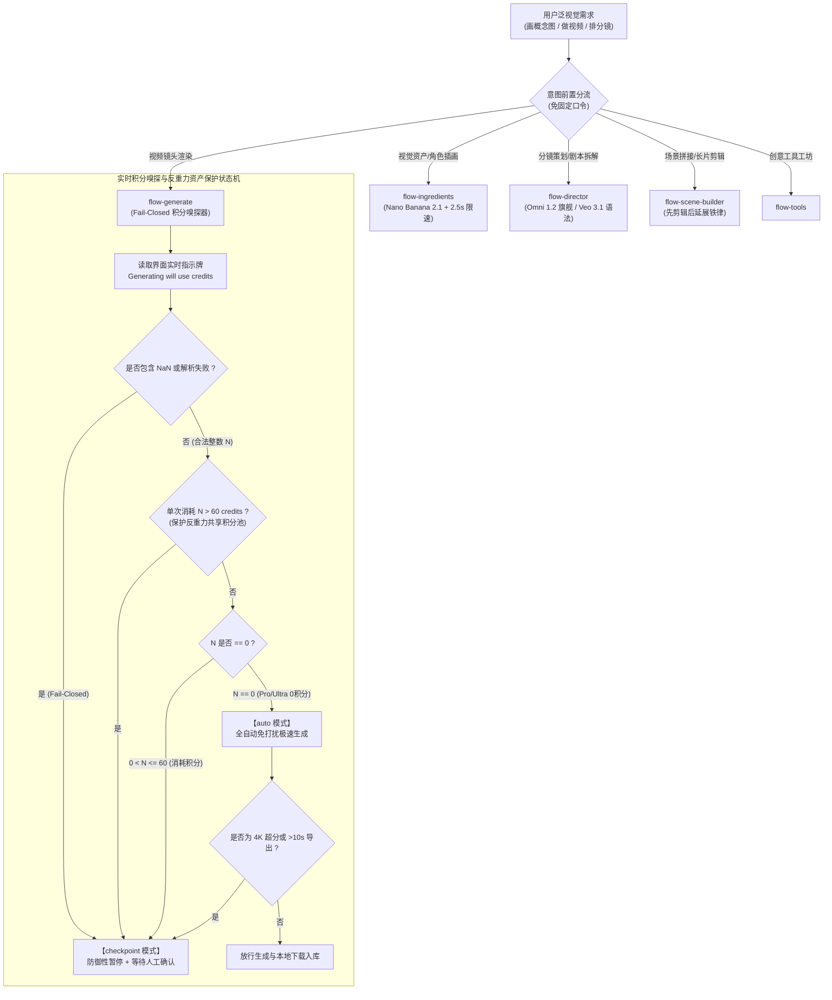

# Antigravity Flow (`antigravity-flow`)

<p align="center">
  
</p>

<p align="center">
  <strong>Production-Grade AI Filmmaking & Multimodal Generation Engine for Google Flow</strong>
</p>

<p align="center">
  <a href="https://github.com/qq136692547-cmyk/antigravity-flow/blob/main/LICENSE"></a>
  <a href="https://qq136692547-cmyk.github.io/"></a>
  <a href="https://flow.google.com"></a>
  <a href="https://github.com/qq136692547-cmyk/antigravity-flow"></a>
</p>


An Antigravity plugin that packages **Google Flow** ([flow.google.com](https://flow.google.com)) as an automated, industrial AI filmmaking and creative-tools workflow powered by Antigravity's built-in `browser` subagent — requiring zero external MCP servers, daemon processes, or headless Playwright binaries.

---

## Key Capabilities

- **Veo 3.1 & Omni 1.2 Five-Slot Grammar**: Turn creative ideas into production-ready prompts using the mandatory `[Cinematography] + [Subject] + [Action] + [Context] + [Style & Ambiance] . [Audio Sentences]` sequence across both Omni 1.2 Flash (flagship) and Veo 3.1 Lite.
- **Velocity Adverb Weight Lowering**: Automatically converts numerical weights (e.g., `(pan:1.4)`, `::2`) into natural velocity adverbs (`subtle`, `smooth`, `steady`, `deliberate`, `rapid`, `sweeping`) calibrated for Veo 3.1 and Omni 1.2 Flash.
- **Fail-Closed Live Credit Sniffer**: Real-time UI indicator inspection (`Generating will use <N> credits` or `Costs <N> credits`). If the web UI outputs `NaN credits` or unparsed text due to hydration latency, halts fail-closed for user confirmation.
- **Shared Google One AI Credit Pool Protection**: Hard spend ceiling of `MAX_CREDIT_CEILING = 60` credits per action even in `auto` mode, preventing unintended exhaustion of the credit pool shared with Antigravity.
- **Dynamic Upscale Duration Gating**: Safely gates 1080p downloads past 10s (1 credit/s) and all 4K upscales (50 credits + 5 credits/s past 10s) with mandatory confirmation checkpoints.
- **Character Consistency via Ingredients**: Seamlessly connects `@handles` across shots, manages 6 starter character archetypes, and handles start/end keyframe choreography with a 2.5s velocity limiter.
- **Scene Sequencing & Clip Editor**: Sequences shots, extracts keyframes (`Save frame`), performs timeline extensions (`Extend`), and enforces the invariant that inline video edits occur prior to clip extension.
- **Creative Tools Studio**: Browse 34 curated templates, spotlight community tools, or build custom zero-credit interactive creative tools in `Create tool`.
- **4-Tier Download Submenu**: Export directly to `270p Animated GIF`, `720p Original size`, `1080p Upscaled` (0 credits for <=10s), or `4K Upscaled · 50 credits` (mandatory confirmation gate).

---

## Installation

### From GitHub

```bash
agy plugin install https://github.com/qq136692547-cmyk/antigravity-flow
```

### Local Development

```bash
git clone https://github.com/qq136692547-cmyk/antigravity-flow.git
# Link into your Antigravity plugins directory:
ln -s "$(pwd)/antigravity-flow" ~/.gemini/config/plugins/antigravity-flow
```

---

## Operating Contract (`rules/AGENTS.md`)

When active, `rules/AGENTS.md` governs browser navigation and safety bounds:

1. **Direct Canonical URL**: Navigates directly to `https://flow.google.com/` (preventing redundant SSO redirect hops).
2. **Fast-Path Authentication**: Uses above-the-fold visual signals, user avatar, and network HTTP 200 telemetry to bypass login prompts if already authenticated.
3. **Fail-Closed Credit Sniffer & Pool Protection**:
   - `0 credits`: Executes automatically without interruption (`auto` mode).
   - `> 0 credits`: Halts in `checkpoint` mode, displays exact credit quote, and awaits user confirmation.
   - `NaN / Unparsed`: Halts fail-closed in `checkpoint` mode if credit text contains `NaN` or fails to parse.
   - `MAX_CREDIT_CEILING = 60`: Actions exceeding 60 credits pause for confirmation even in `auto` mode to safeguard Antigravity's shared credit pool.
   - `Dynamic Upscale Gating`: Upscales >10s and all 4K upscales require explicit confirmation.
   - `Rate Pacing`: Loops maintain a 2.5s delay between generation dispatches to prevent velocity locks.
4. **Sandboxed File Staging**: Uploads stage through `<Artifact>/browser_sandbox/uploads/`, references through `browser_sandbox/references/`, and downloads stage to `browser_sandbox/downloads/`.

---

## Included Skills

| Skill | Mode | Role | Key Reference |
| :--- | :--- | :--- | :--- |
| **`flow-director`** | Autonomous | Storyboard planner, Veo 3.1 & Omni 1.2 5-slot grammar, velocity adverb lowering | `references/veo-prompt-guide.md` |
| **`flow-ingredients`** | Autonomous | Character archetype creator, reference library, 0-credit image generator, 2.5s pacer | None |
| **`flow-generate`** | Autonomous | Video & image shot generator, fail-closed sniffer, credit ceiling, batch runner | None |
| **`flow-scene-builder`** | Autonomous | Scene sequencing, timeline extensions, frame extraction, edit-before-extend invariant | None |
| **`flow-tools`** | Autonomous | Curated template runner, community tool explorer, custom tool builder | `references/tools-catalog.md` |
| **`flow-sync`** | Manual Only | Zero-credit 7-surface live audit crawler for UI drift and model deprecation | `references/audit-checklist.md` |

---

## Veo 3.1 Prompting Formula

Structure prompts according to the 5-slot formula:

```
[Cinematography] + [Subject] + [Action] + [Context] + [Style & Ambiance] . [Audio Sentences]
```

### Example
```
Low-angle tracking shot, 35mm anamorphic lens, slow steady push-in, @detective_chen walks cautiously forward through the rain-slicked alleyway, tall brick walls adorned with buzzing holographic neon signs, cinematic teal and amber color grade with photorealistic volumetric smoke. Ambient noise: steady rainfall dripping onto metal fire escapes. SFX: leather boots splashing softly in puddles. @detective_chen speaks in a calm whisper: "The trace ends here."
```

---

## Autonomy Modes

- **`checkpoint` Mode (Default)**: The agent configures model parameters, calculates exact credit cost via the Live Credit Sniffer, presents a pre-flight table, and awaits confirmation before clicking `Start generation`.
- **`auto` Mode (Full-Auto)**: Mention `"auto mode"`, `"full-auto"`, `"run unattended"`, or `"without asking"` to execute planning, ingredient setup, shot rendering, and local downloads end-to-end without per-shot confirmation (capped at `MAX_CREDIT_CEILING = 60`).

---

## Verification Suite

Run the comprehensive 6-tier test suite:

```bash
python tests/run_tests.py
```

Test coverage (29/29 passing):
- **Tier 1**: Manifest Schema & Skill Integrity (frontmatter, author metadata, references).
- **Tier 2**: Live Credit Sniffer & Plan Badge Parsing (Pro 0-credit vs Free charge regex).
- **Tier 3**: Autonomy Modes & Security Bounds (auto vs checkpoint, 4K upscale gate).
- **Tier 4**: Veo 3.1 5-Slot Grammar & Storyboard Parser (AST validation, velocity adverbs).
- **Tier 5**: Adversarial Hardening (Zero-CJK codebase check, ReDoS safety, deprecation check).
- **Tier 6**: Live Grounding & Credit Hardening (Fail-Closed NaN sniffer, ceiling gate, dynamic upscale duration, 2.5s pacing, edit-before-extend invariant).

---

## Author & License

- Author: **qq136692547-cmyk** ([Personal Hub](https://qq136692547-cmyk.github.io/))
- Repository: [GitHub](https://github.com/qq136692547-cmyk/antigravity-flow)
- License: MIT

---

# 中文使用与架构进阶指南

## 1. 项目定位与生态闭环

`antigravity-flow` 是专为 Google Flow (`https://flow.google.com`) 打造的工业级多模态影视生成插件。它与 `antigravity-aistudio`（云端深度思考与代码分流）形成双轮驱动，构建起从**文本构思 -> 分镜拆解 -> 角色资产库 -> 视频分镜生成 -> 时间线剪辑 -> 4K高清导出**的完整自动化链路。

## 2. 核心架构与风控状态机



## 3. 六大核心技能详细分工

1. **`flow-director`（分镜总监）**：
   - 零积分消耗。将故事梗概拆解为结构化 `storyboard.md`。
   - 旗舰主推 `Omni 1.2 Flash`（支持 360p 极速草稿与 720p 旗舰成片），明确标注文生视频五段式语法与 12月5日 Veo Quality/Fast 下线倒计时。
2. **`flow-ingredients`（资产与角色库）**：
   - 管理 6 种官方角色预设原型，支持一键上传与 Nano Banana 2.1 零积分生图，自动内置 2.5s 节奏等待防 24h 限流。
3. **`flow-generate`（视频分镜渲染）**：
   - 内置 Fail-Closed 实时积分嗅探器，严防 SPA 延迟渲染导致的 `NaN credits` 漏检，设置 60 积分硬顶防护反重力共用额度。
4. **`flow-scene-builder`（时间线剪辑器）**：
   - 严格执行“剪辑优先于延展”铁律（Live 网页限制延展后不可再行原位编辑），延展能力独家绑定 `Omni 1.2 Flash`。
5. **`flow-tools`（创意工具工坊）**：
   - 操作 34 款官方与社区创意工具，支持 0 积分一句话构建专属轻应用。
6. **`flow-sync`（零消耗巡检自愈）**：
   - 仅手动触发（`disable-model-invocation: true`）。针对 Flow 网页 7 大交互界面进行只读巡检，自愈漂移与废弃模型。

## 4. Veo 3.1 运镜副词速查表

| 运镜强度 | 替代的数字权重 | 推荐速度副词短语 | 典型示例 |
| :--- | :--- | :--- | :--- |
| **极微弱** | `0.2 - 0.4` | `subtle, barely perceptible` | `Subtle, barely perceptible camera drift` |
| **平缓柔和** | `0.5 - 0.8` | `smooth, gentle, measured` | `Smooth, gentle crane down revealing subject` |
| **基准标准** | `1.0` | `steady, cinematic, controlled` | `Steady, controlled tracking shot alongside car` |
| **明确动感** | `1.2 - 1.5` | `deliberate, pronounced, brisk` | `Deliberate, pronounced dolly push-in` |
| **极速戏剧** | `1.6 - 2.0` | `rapid, sweeping, dramatic` | `Rapid, sweeping whip pan to the horizon` |
